# 자취선배 #566

- PR: https://github.com/woowacourse-teams/2026-jachwi-sunbae/pull/566
- 제목: [FE][Fix] 동네 찾기 결과 지도와 바텀시트를 덜 다시 그리게 하고 확대, 경로 시점, 시트 끌기를 고친다
- 이슈: #542, #543, #556, 브랜치: `fix/542-neighborhood-map-rendering`
- 커밋: 6a256fa1, 54af3324, cdc48e9a, ed2cb214, 938521a6, debe4f0e, 2f868d25, 66e06c1a, a53aebea, f9385310, 77e244c9, 499ff27e

GIF는 모두 왼쪽이 고치기 전(develop `c3e931c5` 운영 빌드), 오른쪽이 고친 뒤다. 로컬 운영 빌드를 `/api`만 dev API로 넘기는 정적 서버(3031)로 띄우고 Mac 시스템 Chrome(Playwright, 헤드리스)으로 녹화했다. dev API 익명 회원, 목적지는 판교(지도 가운데를 찍음), 통근 40분, 환승 1회, 2026-11-04, 각 1회 녹화. 운영 API와 운영 사이트는 쓰지 않았다.

| 파일 | 내용 | 출처 |
| --- | --- | --- |
| `tab-switch.gif` | 동네 시트 탭 전환(정류장 → 공인중개사 → 정류장). 두 쪽 모두 고른 탭 마커만 남는다. 오른쪽은 마커를 다시 붙여 쓴다 | 390x844, CPU 4x는 탭을 누르는 구간만. 오른쪽은 `debe4f0e`(공인중개사 탭을 빼기 전) |
| `result-drag.gif` | 결과 지도 드래그 세 번 | 390x844, CPU 4x, 오른쪽 `debe4f0e`. 6fps로 줄임 |
| `sheet-drag.gif` | 동네 시트를 손잡이로 끌어 올렸다 내리기. 오른쪽은 끄는 동안 `transform`만 바꾼다 | 390x844, CPU 4x, 오른쪽 `debe4f0e` |
| `area-sheet-768.gif`, `area-sheet-1023.gif` | 태블릿 폭에서 동네 시트를 끝까지 끌어 올리기. 왼쪽은 30rem 가운데, 오른쪽은 화면 폭을 채운 페이지 | 768x1024(오른쪽 `debe4f0e`), 1023x768(오른쪽 `77e244c9`) |
| `meal-sheet-390.gif`, `meal-sheet-768.gif`, `meal-sheet-1023.gif` | 저렴한 한 끼 가게 목록 시트를 끝까지 끌어 올리기. 왼쪽은 90%에서 멈추고, 오른쪽은 페이지로 연다 | 각 폭, 오른쪽 `77e244c9` |
| `nearby-sheet-390.gif`, `nearby-sheet-768.gif`, `nearby-sheet-1023.gif` | 주변 분석 시트. 왼쪽은 끌리지 않아 '시설 목록 보기'로 펼치고, 오른쪽은 공용 시트로 끌어 페이지까지 연다 | 삼평동 좌표, 각 폭, 오른쪽 `77e244c9` |
| `station-route.gif` | 휴대폰에서 1위 동네의 첫 출발 정류장을 누름. 왼쪽은 정류장 한 점에 3단계로 다가가 출퇴근 장소가 화면 밖, 오른쪽은 정류장과 출퇴근 장소가 함께 보인다 | 390x844, 오른쪽 `77e244c9` |
| `desktop-station-route.gif` | 데스크탑에서 1위 동네를 고르고 첫 출발 정류장을 누름 | 1280x800, 오른쪽 `77e244c9` |
| `memo-deselect.gif` | 동네를 골랐다 풀어 가까이 본 채 결과 지도로 돌아옴. 왼쪽은 dev의 거리 메모가 보이고 오른쪽은 없다 | 390x844, 오른쪽 `77e244c9` |
| `zoom-buttons.gif` | 고친 뒤만. 결과 지도의 확대 두 번, 축소 한 번 버튼 | 390x844, `77e244c9` |

## 탭 상태별 지도에 올라간 마커 수 (콘티 제보 계측)

`useNaverMap`의 마커 동기화 끝에 임시 계측을 넣어(커밋하지 않고 측정 뒤 지움) 지도에 붙은 오버레이를 종류별로 세고, 같은 순간 지도 DOM의 마커 수와 요청된 마커 목록을 함께 적었다. 개발 서버 3031, dev API, 2026-11-04, 브랜치 커밋 `ed2cb214`(지도 마커 코드는 develop과 같음). 삼평동 화면 안에 dev 거리 메모 3~5개가 있다.

## 휴대폰 390x844

| 상태 | 탭 | 지도에 붙은 마커(종류별) | 합계 | 지도 DOM | 요청된 마커 |
| --- | --- | --- | ---: | ---: | --- |
| 0 없음(결과 전체) | 없음 | area-rank 5, destination 1 | 6 | 6 | area-rank 5, destination 1 |
| 1 정류장 탭(삼평동) | 정류장 43(선택), 공인중개사 45 | bus-stop 151, destination 1 | 152 | 152 | bus-stop 151, destination 1 |
| 2 정류장 탭(메모 자리가 화면 안) | 정류장 43(선택), 공인중개사 45 | bus-stop 151, destination 1 | 152 | 152 | bus-stop 151, destination 1 |
| 3 공인중개사 탭 | 정류장 43, 공인중개사 45(선택) | agency 45, destination 1 | 46 | 46 | agency 45, destination 1 |
| 3-1 다시 정류장 탭 | 정류장 43(선택), 공인중개사 45 | bus-stop 151, destination 1 | 152 | 152 | bus-stop 151, destination 1 |
| 4 없음(동네 선택 해제) | 없음 | bus-stop 151, agency 45, street-memo 3, destination 1 | 200 | 200 | bus-stop 151, agency 45, street-memo 3, destination 1 |

## 데스크탑 1440x900

| 상태 | 탭 | 지도에 붙은 마커(종류별) | 합계 | 지도 DOM | 요청된 마커 |
| --- | --- | --- | ---: | ---: | --- |
| 0 없음(결과 전체) | 없음 | area-rank 5, destination 1 | 6 | 6 | area-rank 5, destination 1 |
| 1 정류장 탭(삼평동) | 정류장 43(선택), 공인중개사 45 | bus-stop 249, destination 1 | 250 | 250 | bus-stop 249, destination 1 |
| 2 정류장 탭(메모 자리가 화면 안) | 정류장 43(선택), 공인중개사 45 | bus-stop 249, destination 1 | 250 | 250 | bus-stop 249, destination 1 |
| 3 공인중개사 탭 | 정류장 43, 공인중개사 45(선택) | agency 45, destination 1 | 46 | 46 | agency 45, destination 1 |
| 3-1 다시 정류장 탭 | 정류장 43(선택), 공인중개사 45 | bus-stop 249, destination 1 | 250 | 250 | bus-stop 249, destination 1 |
| 4 없음(동네 선택 해제) | 없음 | bus-stop 385, agency 45, street-memo 5, destination 1 | 436 | 436 | bus-stop 385, agency 45, street-memo 5, destination 1 |
결론: 모든 상태에서 지도에 붙은 수, DOM 수, 요청된 수가 같다(이전 탭 마커 0). 메모는 동네를 고르지 않은 상태(4)에서 메모 레이어로만 들어왔다. 그래서 #543에서 메모 레이어를 뺐다.

## 숫자 출처

성능 숫자는 PR 본문과 `frontend/docs/rendering-performance-report.md`에 있다. 원본 트레이스, React 커밋 기록, 회차별 값은 측정한 Mac의 `~/Documents/jachwi-perf/perf-rendering/`(`2026-11-04-ab-sheets-markers`, `2026-11-04-ab-zoom`, `2026-11-04-tab-marker-count` 등) README에 있다. 측정 조건은 390x844 DPR 3, CPU 4x, develop `c3e931c5`와 같은 시간대에 번갈아 3회.

## 사용자 확인 뒤 고친 것 (`user-report/`)

다섯 PR(561, 562, 564, 565, 566)을 합친 화면에서 확인한 보고를 고쳤다. 개선 전은 합친 확인 서버(`verify/all-open-prs`, 3040), 개선 후는 같은 다섯 브랜치에 이 브랜치 커밋 `e9d2dba6`을 합친 로컬 임시 브랜치(3031). dev API, 2026-11-04, Playwright 시스템 Chrome 헤드리스, DPR 1.

| 파일 | 내용 |
| --- | --- |
| `zoom-390-selected-before.png`, `-after.png` | 휴대폰 390x844에서 동네를 고른 뒤. 전: 확대 축소 버튼(y 512~554)이 동네 시트(y 523부터) 손잡이에 가림. 후: 시트 바로 위(y 419~511)에 붙음 |
| `zoom-768-selected-before.png`, `-after.png` | 태블릿 768x1024에서 같은 상황. 전: 버튼(y 692~734)이 시트(y 635부터) 헤더에 가림. 후: y 531~623 |
| `meal-390-before.png`, `-after.png` | 저렴한 한 끼 식당 목록 시트를 끝까지 끌어 올린 뒤. 전: 지도 칸(y 186~844)까지만 덮어 머리와 탭이 남음. 후: 화면 전체(y 0~844) |
| `explore-390-before.png`, `-after.png` | 휴대폰 첫 화면. 전: 아래 띠 안내와 `<` 버튼. 후: 본 방 기록과 같은 공용 지도 안내(`MapTapIntro`)와 집 모양 버튼 |
| `explore-768-before.png`, `-after.png` | 태블릿 첫 화면. 전: 조건 시트가 가운데 480px(x 144~624). 후: 화면 폭(x 0~768) |
| `desktop-station-marker-before.gif`, `-after.gif` | 데스크탑 1280x800, 1위 동네를 고르고 요약의 첫 출발 정류장을 누른 뒤 지도의 그 정류장 마커를 누름. 전: 마커를 누르면 지도 빈 곳 누르기로 넘어가 경로 칸이 닫히고 지도 폭이 바뀜. 후: 경로 칸이 그대로 남음 |

사용자 녹화의 "경로 시점과 확대 상태 사이를 오가며 튐"은 헤드리스에서 그대로 재현되지 않았다. 녹화 프레임에서 본 두 현상(폭이 바뀐 뒤 캔버스가 옛 크기로 남았다가 빈 화면이 됨, 옮기는 도중 다른 시점이 섞임)에 맞춰, 옮기기 전에 지도 크기를 맞추고 옮기는 도중의 idle을 무시하게 고쳤다(단위 테스트로 확인).

## PR 본문에서 옮긴 자세한 내용

PR 본문을 짧게 줄이면서 이슈별 변경 표, 전체 전후 그림, 측정 표와 조건, 시도 과정, 확인하지 못한 것, 자세한 리뷰 요청을 이곳으로 옮겼다(2026-11-04).

### 작업 내용 (이슈별 표)

**#542 동네 찾기 결과 지도 렌더링**

| 변경 | 내용 |
| --- | --- |
| 금액 문구 형식기 재사용 | `formatManwon`이 부를 때마다 `toLocaleString`으로 형식기를 준비해 분석 직후 40~70ms(CPU 4x)를 썼다. `Intl.NumberFormat` 하나를 재사용한다 |
| 시트 끌기 `transform` | 공용 `BottomSheet`가 `pointermove`마다 React 상태로 `height`를 바꿨다. 끌기 시작에 한 번만 늘리고 그 뒤는 `translateY`만 바꾼다 |
| 마커 재사용 | 마커 동기화를 `mapMarkerLayer`로 꺼내, 내린 마커는 id와 모양이 같으면 다시 붙인다. 요청에 없는 마커는 언제나 지도에서 내린다(이전 탭 마커가 사라지는 테스트) |
| 지도가 멈출 때 리렌더 줄이기 | `idle`마다 화면 범위를 상태로 바꿔 동네 찾기 화면 전체(약 35개)가 다시 렌더됐다. 가까이 확대해 조회할 때만 상태로 올린다 |

**#543 결과 지도 조작과 표시**

| 변경 | 내용 |
| --- | --- |
| 확대 축소 버튼 | 현재 위치 버튼 위에 `MapZoomControl`. 휠로 바꾼 단계에서 한 단계씩 옮긴다 |
| 메모 빼기 | 결과 지도에서 거리 메모 레이어를 뺀다(조회도 안 한다) |
| 중개 탭 빼기 | 휴대폰 시트와 데스크탑 요약에서 공인중개사 탭을 빼고 출발 정류장 목록만 둔다. 동네를 고른 동안 지도에는 정류장 마커만 |
| 경로 시점 | 상위 동네를 고르면 동네 경계, 첫 출발 정류장, 출퇴근 장소가, 출발 정류장을 고르면 정류장과 출퇴근 장소가 한 화면에 들어오게 옮긴다(`routeFocusView`, 5~10단계) |

**#556 공용 바텀시트**

| 변경 | 내용 |
| --- | --- |
| 태블릿 폭 | 30rem 가운데 띄우기를 768px에서 1024px부터로 올려 태블릿은 화면 폭을 채운다 |
| `fullPage` 기본 | 끝까지 끌어 올리면 페이지로 여는 동작을 기본으로. 저렴한 한 끼, 본 방 기록 시트도 페이지까지 올라간다 |
| 주변 분석 시트 | `MapNearbySheet`를 공용 시트로 옮겨 네 단계를 끌어서 오가고, 시설을 고르면 상세 카드를 가리지 않게 제목만 보이게 내린다 |

문서: [렌더링 성능 리포트](https://github.com/woowacourse-teams/2026-jachwi-sunbae/blob/fix/542-neighborhood-map-rendering/frontend/docs/rendering-performance-report.md)를 새로 두고, 동네 찾기와 거리 메모, 시트 설명을 바뀐 동작에 맞췄다.

### 그림, 측정, 시도 과정

그림은 모두 왼쪽이 고치기 전(develop), 오른쪽이 고친 뒤다. 출처와 조건은 [그림 폴더 README](https://github.com/iftype/project-asset/tree/main/jachwi-sunbae/566)에 있다.

**#542**

| 동네 시트 탭 전환 (CPU 4x) | 결과 지도 드래그 (CPU 4x) | 동네 시트 끌기 (CPU 4x) |
| --- | --- | --- |
| 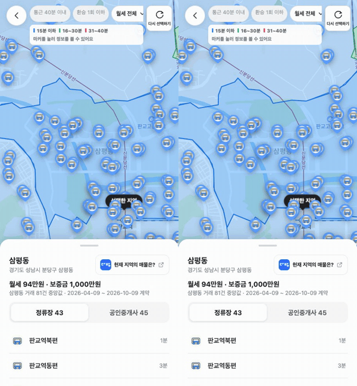 | 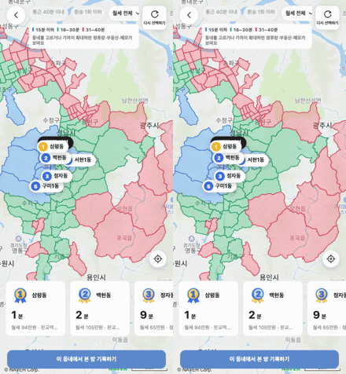 | 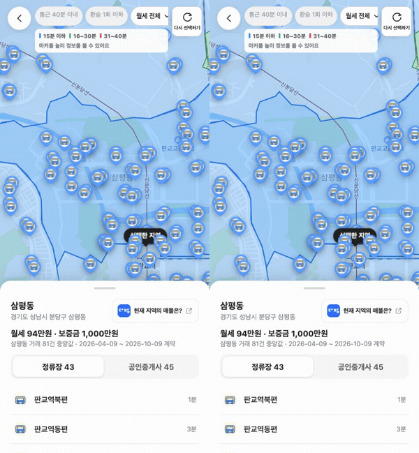 |
| 두 쪽 모두 고른 탭 마커만 남는다. 오른쪽은 내린 마커를 다시 붙여 쓴다 | 오른쪽은 지도가 멈춰도 화면 전체를 다시 렌더하지 않는다 | 오른쪽은 끄는 동안 `transform`만 바꾼다 |

**#543**

| 출발 정류장 누르기 (휴대폰) | 출발 정류장 누르기 (데스크탑) | 동네 선택을 푼 뒤 메모 | 확대 축소 버튼 (고친 뒤) |
| --- | --- | --- | --- |
| 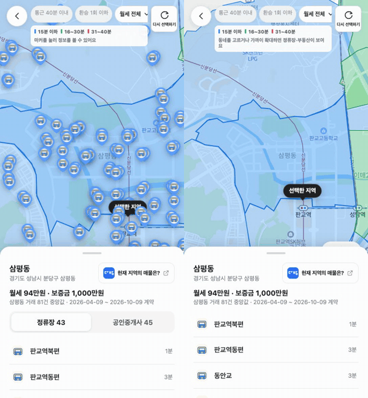 | 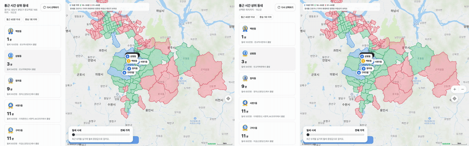 | 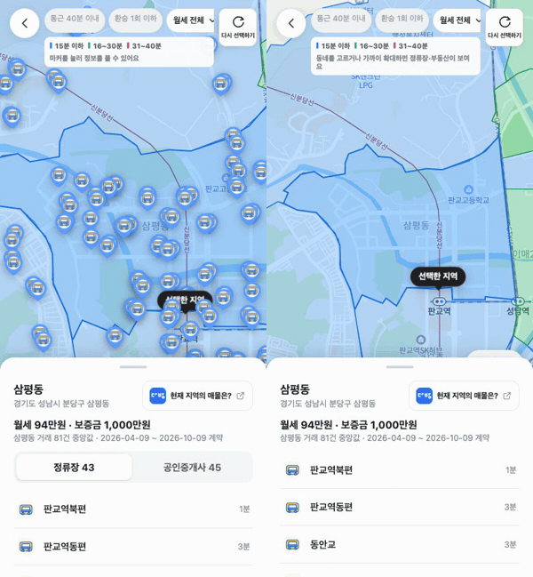 | 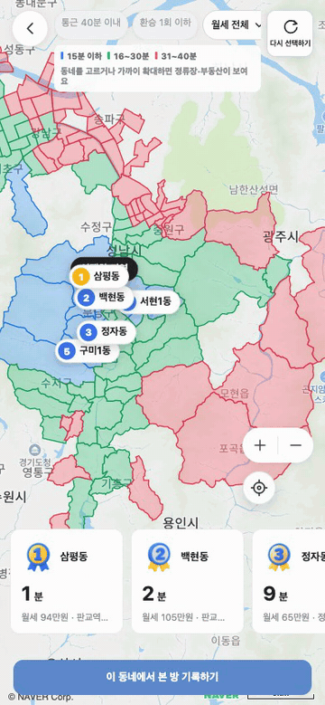 |
| 왼쪽은 정류장 한 점에 다가가 출퇴근 장소(선택한 지역)가 화면 밖, 오른쪽은 함께 보인다 | 같은 동작의 데스크탑 | 왼쪽은 거리 메모가 보이고 오른쪽은 없다. 오른쪽은 공인중개사 탭도 없다 | 확대 두 번, 축소 한 번 |

**#556 시트를 끝까지 끌어 올리기**

| 화면 | 390px | 768px | 1023px |
| --- | --- | --- | --- |
| 동네 시트 | (탭 전환, 시트 끌기 GIF) | 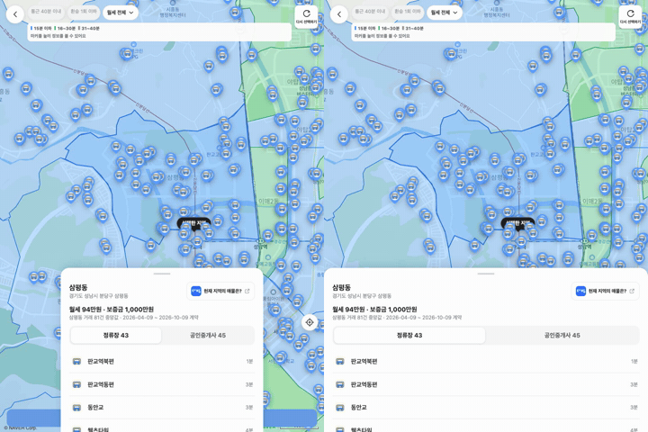 | 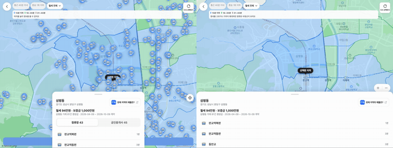 |
| 저렴한 한 끼 | 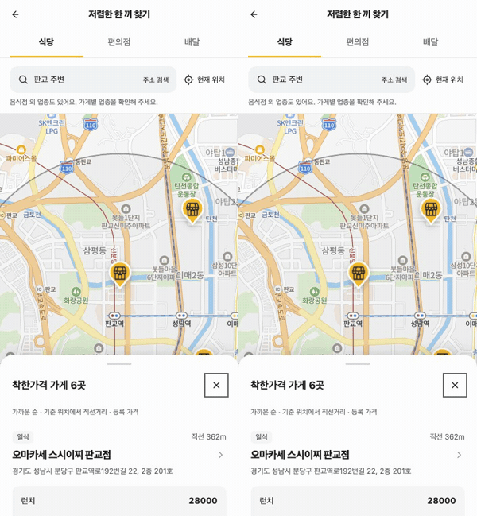 | 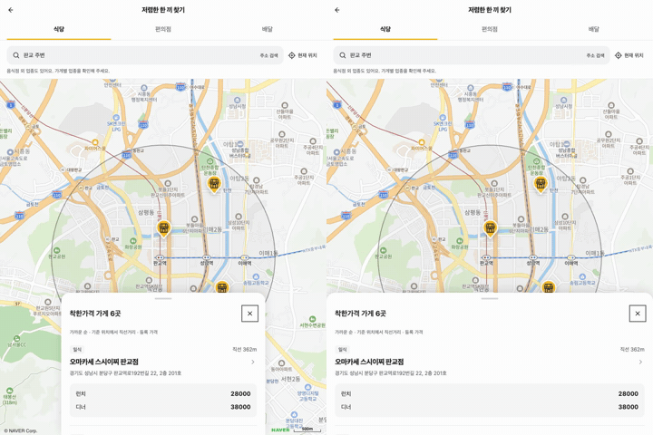 | 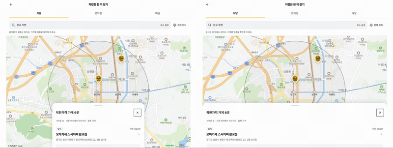 |
| 주변 분석 | 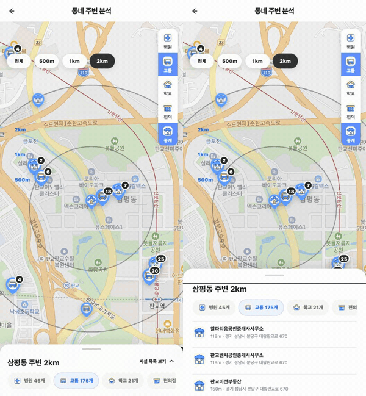 | 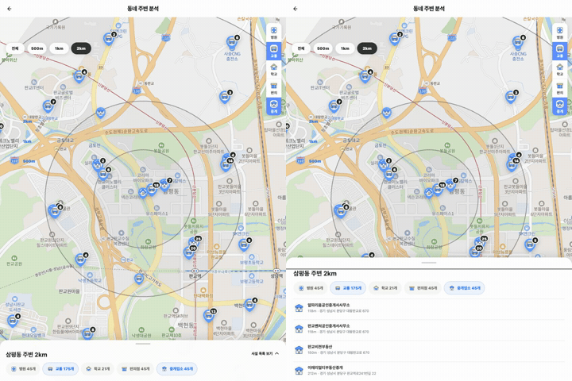 | 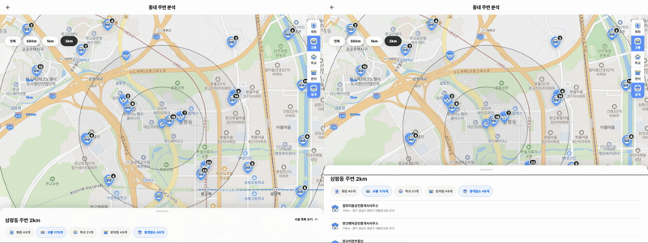 |

왼쪽은 태블릿에서 30rem 가운데에 뜨고 끝까지 끌어도 중간에서 멈춘다(주변 분석은 끌리지 않아 버튼으로 펼친다). 오른쪽은 화면 폭을 채우고 뒤로가기와 닫기가 있는 페이지로 열린다. 본 방 기록 시트는 측정용 익명 계정에 매물이 없어 GIF 대신 화면별 끌기 네 단계 테스트로 확인했다.

**사용자 확인 뒤 고친 것 (다섯 PR 561, 562, 564, 565, 566을 합친 화면 기준)**

| 보고 | 원인 | 고친 것 |
| --- | --- | --- |
| 휴대폰, 태블릿에서 확대 축소 버튼이 안 보임 | 동네 시트(38%)가 버튼 자리를 덮음 | 시트를 띄우면 버튼을 시트 바로 위(`BottomSheet`의 `floating`)에 붙여 함께 오르내림. 페이지로 열면 숨김 |
| 데스크탑에서 출발 정류장 마커를 누르면 지도가 튐 | 출발 정류장 마커가 누를 수 없는 마커라 지도 빈 곳 누르기로 넘어가 경로 칸이 닫히고 지도 폭이 바뀜. 폭이 바뀐 채 옮기면 옛 크기로 옮긴 뒤에야 크기를 맞추고, 옮기는 도중의 idle이 중간 시점을 화면에 알려 다시 옮김 | 마커를 누를 수 있게 하고 고른 경로를 그대로 둠. 옮기기 전에 크기를 맞추고 옮기는 도중의 idle은 받지 않음(목표에 닿거나 700ms 뒤에 받음) |
| 튜토리얼 오버레이 모양이 다름 | 동네 찾기만 따로 만든 아래 띠 안내 | 본 방 기록의 안내를 공용 `MapTapIntro`로 빼고 두 화면이 함께 씀 |
| 저렴한 한 끼 시트가 맨 위까지 안 감 | 페이지 모드가 시트가 든 지도 칸까지만 덮음 | 페이지 모드는 화면 전체(`position: fixed`)를 덮음 |
| 뒤로 가기 `<` | - | 공용 아이콘 `home`으로 바꿈(동작은 그대로) |
| 태블릿에서 시트가 좌우를 안 채움 | 동네 찾기 조건 시트만 공용 `BottomSheet`가 아닌 자체 시트에 `max-width: 30rem` | 폭 제한을 빼 공용 시트처럼 화면 폭을 채움 |

| 보고 | 개선 전 | 개선 후 |
| --- | --- | --- |
| 휴대폰 확대 버튼 | 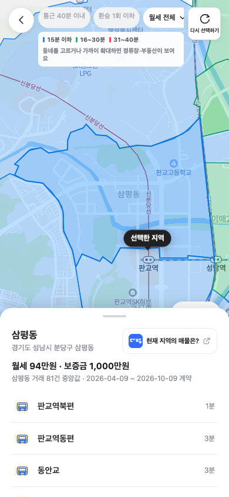 | 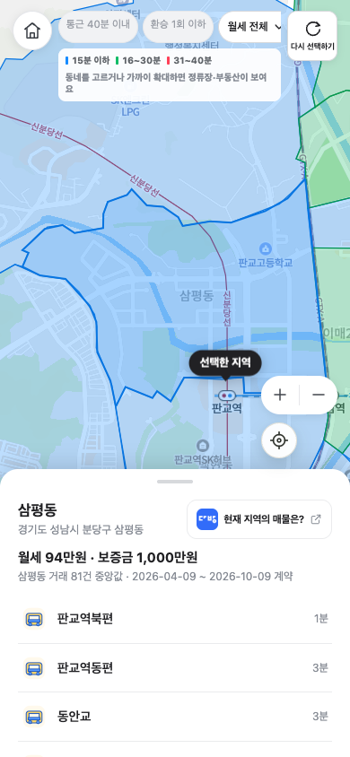 |
| 태블릿 확대 버튼 |  | 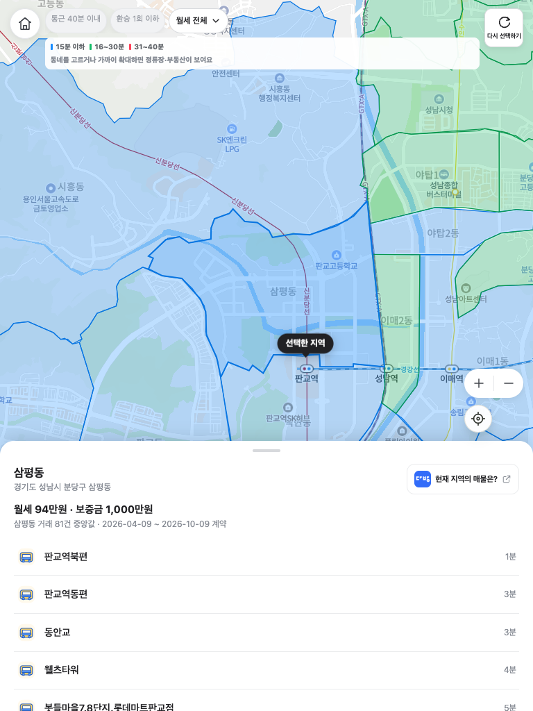 |
| 저렴한 한 끼 시트 끝까지 | 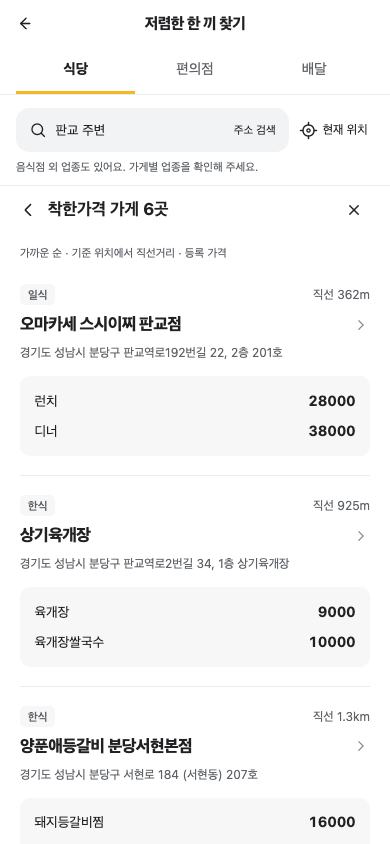 | 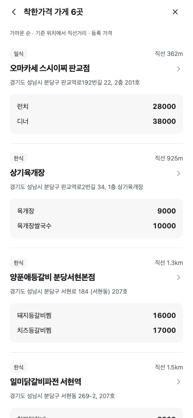 |
| 안내와 집 모양 버튼 | 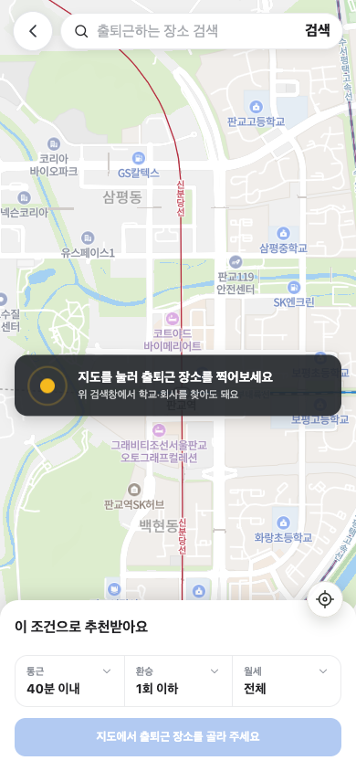 | 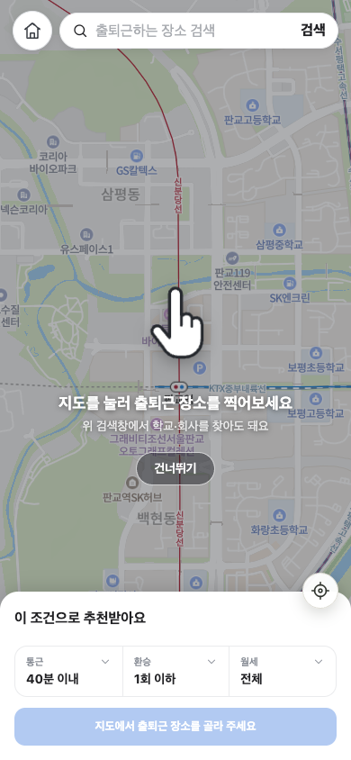 |
| 태블릿 조건 시트 폭 | 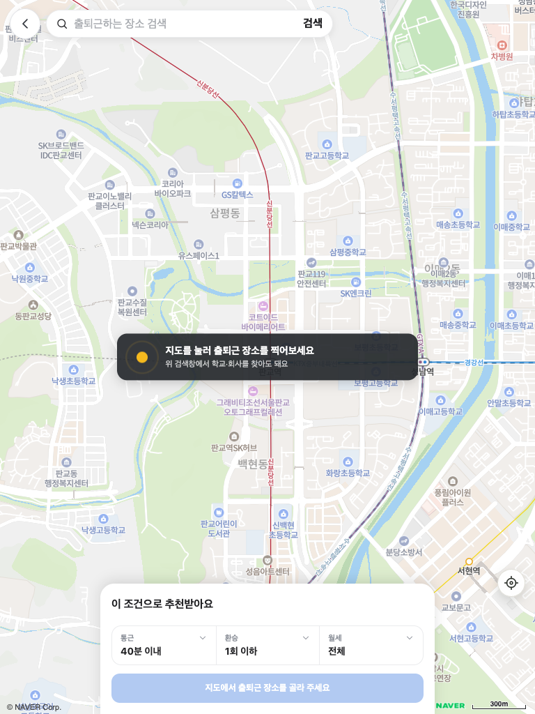 | 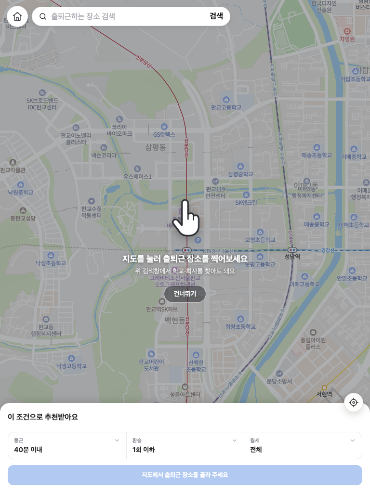 |
| 데스크탑 정류장 마커 |  | 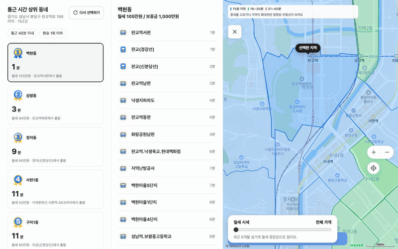 |

- 사용자 녹화의 "경로 시점과 확대 상태 사이를 오감"은 헤드리스에서 그대로 재현되지 않았다. 녹화 프레임(폭이 바뀐 뒤 캔버스가 옛 크기로 남았다 빈 화면, 다른 시점이 섞임)에 맞춰 고쳤고 단위 테스트로 확인했다. 실기기에서 한 번 더 봐야 한다.

**측정 (develop `c3e931c5`와 같은 시간대에 번갈아 3회, 390x844, CPU 4x, dev API, 로컬 운영 빌드)**

| 지표 | 개선 전 | 개선 후 |
| --- | --- | --- |
| 결과 지도 드래그 3번의 컴포넌트 렌더 수 | 105, 105, 70 / 105, 105, 105 | 3, 3, 3 / 3, 3, 3 |
| 휠 확대 축소 4번의 컴포넌트 렌더 수 | 105, 210, 140 / 210, 315, 315 | 7, 7, 7 / 9, 8, 9 |
| 동네 시트 탭 전환 2번 INP 후보 | 1979, 884, 587 ms | 591, 304, 417 ms |
| 시트 끌기 2번 React 커밋 / Rendering / Painting | 31 / 77.7 ms / 210.2 ms | 1 / 20.9 ms / 82.8 ms |
| 분석 한 번의 `formatManwon` 자기 시간 | 39.8~72.2 ms | Bottom-Up 상위 20 밖 |
| 휠 확대 축소 long task 합 (2회차) | 1.92, 1.03, 0.73 s | 0.77, 0.74, 0.67 s |
| 핀치(ctrl+휠 60번) long task 합 (2회차) | 2.81, 0.70, 0.38 s | 2.57, 1.94, 0.55 s |

- 지도 드래그와 확대 축소의 프레임은 1회차에서 개선 전만 크게 나빴는데(드래그 long task 합 33~99초) 2회차에서 재현되지 않았다. 차이가 흔들림 안팎이라 **프레임이 좋아졌다고 보지 않는다**. 확인된 것은 리렌더 감소, 탭 전환, 시트 끌기다.
- 결과 지도 버벅임의 본체는 네이버 GL이 동 경계 소스마다 매 프레임 타일을 계산하는 비용(`_updateSources → coveringTiles → intersects`)이다. `naver.maps.Data`로 바꿔도 같았다(경기 601개 실험). 화면 밖 경계 빼기, Canvas로 그리기는 이번에 하지 않았다.
- "이전 탭 마커가 남는다"와 "매물 등록에서 단 메모가 보인다"는 탭 상태마다 지도에 올라간 마커를 세어 가렸다. 모든 상태에서 지도에 붙은 수, DOM 수, 요청된 수가 같았고(이전 탭 마커 0), 메모는 동네를 고르지 않은 상태에서 메모 레이어로 들어왔다. 그래서 #543에서 메모 레이어를 뺐다. 표는 그림 폴더 README에 있다.
- 동네를 고르면 #530처럼 6.5단계 안으로 다가가지 않고 경로 전체가 보이게 옮기므로, 경로가 길면 정류장, 부동산 마커는 더 확대해야 보인다(#543 완료 조건을 따랐다).

**확인하지 못한 것 (실기기 확인 필요)**

- [ ] 트랙패드 확대 축소 중 지도가 하얗게 비는 현상: 헤드리스 Chrome에서 재현하지 못했다(래스터 타일 0개, GL 캔버스 정상). 이 PR로 고쳐졌는지 모른다.
- [ ] 리렌더가 지도를 다시 그리게 만든 경로: 1회차에서 개선 전만 드래그 뒤 입력 없이 지도를 10초 넘게 다시 그렸지만 2회차에서 재현되지 않았고 경로도 확인하지 못했다.

### 리뷰 요청 사항 (자세히)

- `mapMarkerLayer`의 재사용 보관함(최대 600개)과 다시 붙일 때의 동작(`OverlayView.setMap(map)` → `onAdd`)
- `BottomSheet`를 끄는 동안 시트를 최대 높이로 늘려 아래로 미는 방식. 시트 맨 아래에 붙은 요소는 끄는 동안 가려졌다가 놓으면 돌아온다. 시트를 쓰는 화면은 모두 부모가 `overflow: hidden`이다
- `fullPage` 기본값 변경으로 페이지로 열리면 안 되는 시트가 있는지, 페이지 모드를 화면 전체(`position: fixed`)로 바꿔 덮이면 안 되는 머리나 탭이 있는지
- 옮기는 도중 idle을 무시하는 기준(목표 좌표와 단계에 닿음, 아니면 700ms)이 손으로 끌거나 휠을 굴릴 때 늦게 느껴지지 않는지

## 트랙패드 핀치 속도와 동네 선택 확대 (2026-11-05)

**핀치 (ctrl+휠).** Playwright로 ctrl+휠 이벤트 40개(deltaY -10씩, 16ms 간격, 합 -400)를 보내고 지도 줌을 전후로 읽었다. 데스크탑 1280x800, CPU 1x, 개발 서버 3031, dev API. 도구와 원본은 `~/Documents/jachwi-perf/perf-rendering/tools/zoom-gesture.cjs`, `2026-11-04-pinch-speed/`.

| 지도 | 고치기 전 줌 변화 | 제스처 중 long task 합 | 고친 뒤 줌 변화 | 제스처 중 long task 합 |
| --- | ---: | ---: | ---: | ---: |
| 동네 찾기 위치 고르기(동 경계 없음) | 0.64 | 0.9 s | 5.77 | 0.1 s |
| 동네 찾기 결과(동 경계 있음) | 0.64 | 4.2 s | 5.77 | 0.2 s |
| 본 방 기록 | 0.64 | 3.9 s | 5 (최대 줌에서 멈춤) | 0.05 s |
| 네이버 지도 웹(map.naver.com, 로그인 없이) | 0.7 | - | - | - |

경계가 있든 없든 같은 제스처에 0.64단계라, 느린 원인은 동 경계 그리기가 아니라 Naver SDK의 ctrl+휠 기본 배율이다. Chrome은 핀치 비율을 `deltaY = -100 ln(scale)`로 보내므로 고친 뒤에는 `-deltaY / (100 ln 2)`단계(손가락을 2배 벌리면 1단계)만큼 `zoomBy`로 커서 자리를 기준으로 바꾼다. 실제 핀치는 2배 벌림이 deltaY 합 약 -69다.

**동네 선택 확대 (`area-fit/`).** 1위 동네(삼평동)를 골랐을 때. 전: 고정 칸 340x300에 맞춰 휴대폰은 동네 왼쪽과 아래가 시트와 화면 밖으로 잘림. 후: 지도 칸에서 가리는 여백(휴대폰 위 조건 줄과 아래 시트 38%, 데스크탑 열릴 상세 칸 폭과 색 기준, 버튼, 월세 상자)을 빼고 남은 칸의 75% 안에 담음.
